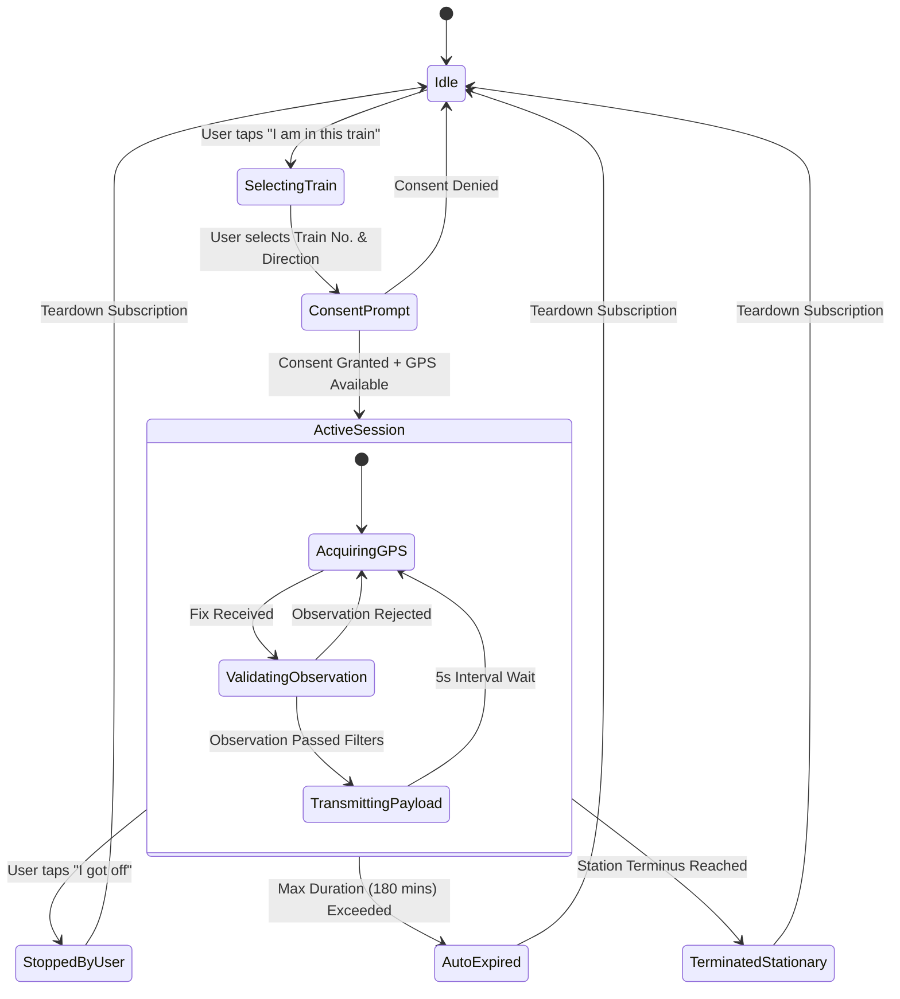

# Crowdsourced Train Tracking Architecture & Data Contracts
**Project:** `M-indicator_V2`  
**Corridor:** Western Railway (Virar ↔ Dahanu Road)  
**Status:** Architecture Design & Contract Specification (Phase 3)

---

## 1. Overview & Core Philosophy

This document defines the architecture, privacy boundaries, geometric validation pipeline, and data contracts for crowdsourced live train tracking in `M-indicator_V2`.

### Guiding Principles
1. **Strict Distinction of Provenance:** Mathematical schedule interpolation (`SCHEDULE_ESTIMATE`) is **never** labeled as live tracking. Only validated passenger GPS reports are labeled `LIVE CROWDSOURCED`.
2. **Explicit User Consent & Opt-In:** No GPS data is ever collected in the background without the passenger explicitly launching a "Track My Train" session.
3. **Zero Personal Identifiable Information (PII):** Sessions use ephemeral, randomly generated UUIDs rotated daily. No phone numbers, account IDs, IP addresses, or permanent device IDs are tied to location payloads.
4. **Edge Pre-filtering:** The client application validates GPS fixes against track geometry *before* transmitting to save battery, mobile bandwidth, and prevent erroneous data from reaching the ingestion cluster.

---

## 2. Session Lifecycle & User Consent State Machine



### Session Lifecycle Rules:
1. **Initialization:** The user selects a specific train number (e.g. `93001`) and confirms direction (e.g. `Virar → Dahanu Road`).
2. **Foreground Only:** Tracking runs exclusively in the foreground during Phase 2/3.
3. **Automatic Termination:**
   - When the user taps **"I have reached my stop"** or **"Stop Sharing"**.
   - When the train arrives at its designated terminal station (e.g. Dahanu Road).
   - Absolute safety timeout: Session automatically expires after 180 minutes to prevent battery drain.

---

## 3. Edge Validation & Outlier Rejection Pipeline

Before any GPS fix is transmitted over the cellular network, it must pass a strict 6-stage verification pipeline implemented in [`src/services/location/`](../location/):

```text
Raw Device GPS Fix (lat, lng, accuracy, speed, timestamp)
   │
   ├── [Filter 1: Horizontal Accuracy] ── accuracy > 75m? ───────► REJECT: ACCURACY_TOO_POOR
   │
   ├── [Filter 2: Freshness] ────────── age > 30s or future? ───► REJECT: STALE_TIMESTAMP
   │
   ├── [Filter 3: Rail Corridor Buffer] ─ distance > 200m track? ─► REJECT: OFF_CORRIDOR
   │
   ├── [Filter 4: Plausible Speed] ───── speed > 130 km/h? ──────► REJECT: IMPLAUSIBLE_SPEED
   │
   ├── [Filter 5: Directional Consistency] progress decreasing? ─► REJECT: WRONG_DIRECTION
   │
   └── [Filter 6: Active Session] ────── session expired? ───────► REJECT: SESSION_INACTIVE
   │
   ▼
VALIDATED OBSERVATION -> Ready for Batch Ingestion
```

### Parameter Thresholds:
| Parameter | Threshold | Justification |
| :--- | :--- | :--- |
| **Max Horizontal Accuracy** | `75 meters` | Filters out cellular tower triangulation / coarse Wi-Fi estimations. |
| **Track Line Buffer** | `200 meters` | Railway tracks have dedicated right-of-way. Points beyond 200m are adjacent highway/road commuters. |
| **Max Suburban Speed** | `130 km/h` | Maximum speed of EMU rakes on WR suburban corridor is 105–110 km/h. |
| **Sampling Cadence** | `Every 5 seconds` | Sufficient spatial resolution while preserving passenger device battery. |

---

## 4. Server Ingestion & Consensus Algorithm

When multiple passengers on the same train transmit observations simultaneously, the server combines them into a single high-confidence location using weighted clustering:

```text
Passenger A (Accuracy ±8m, Speed 62km/h) ──┐
Passenger B (Accuracy ±15m, Speed 60km/h) ─┼──► [Consensus Engine] ──► Aggregated Train Report
Passenger C (Accuracy ±25m, Speed 65km/h) ──┘        (Trimmed Mean)     (High Confidence, 3 Contributors)
```

1. **Cluster Matching:** Group active reports by `(trainNumber, segmentId)`.
2. **Outlier Pruning:** If 3 or more contributors exist, discard the top and bottom 10% spatial extremes.
3. **Inverse-Variance Weighting:** Weights each passenger's reported position inversely proportional to their sensor variance ($\sigma^2 \propto \text{accuracy}^2$):
   $$w_i = \frac{1}{\text{accuracy}_i^2}$$
4. **Delay Calculation:** Compare the consensus progress against scheduled arrival times to compute `delayMinutes`.

---

## 5. Fallback Hierarchy & Graceful Degradation

Passenger displays dynamically degrade through 3 tiers to ensure the app never displays blank screens or misleading info:

| Tier | Condition | Displayed Provenance | UI Indicators |
| :--- | :--- | :--- | :--- |
| **Tier 1: High-Confidence Live** | $\ge 2$ active contributors, last update $< 60\text{s}$ | `LIVE CROWDSOURCED (HIGH)` | Pulsing Green Dot, contributor count, speed in km/h. |
| **Tier 2: Single-Source Live** | $1$ active contributor, last update $< 90\text{s}$ | `LIVE CROWDSOURCED (ESTIMATING)` | Yellow Dot, "1 passenger reporting". |
| **Tier 3: Schedule Fallback** | $0$ contributors OR last update $> 180\text{s}$ | `SCHEDULE TIMETABLE ESTIMATE` | Blue Dot, "Estimated by Timetable", Live badge removed. |

---

## 6. Strict TypeScript Data Contracts

All contracts are defined in [`src/types/tracking.ts`](../types/tracking.ts):

### A. Client Publish Payload
```typescript
export interface CrowdsourcedLocationPayload {
  sessionId: string;            // Anonymized session UUID
  trainNumber: string;          // e.g. "93001"
  routeId: string;              // e.g. "WR_VR_DRD_DN"
  latitude: number;             // Decimal degrees
  longitude: number;            // Decimal degrees
  accuracy: number;             // Horizontal error in meters
  speedKmh: number | null;      // Speed in km/h
  heading: number | null;        // Bearing 0-359 deg
  segmentFrom: string;          // Station code e.g. "VR"
  segmentTo: string;            // Station code e.g. "VTN"
  segmentRatio: number;         // 0.0 to 1.0 along segment
  timestamp: number;            // Epoch milliseconds
}
```

### B. Aggregated Consumer Feed (Received by Waiting Commuters)
```typescript
export interface AggregatedTrainLiveReport {
  trainNumber: string;
  routeId: string;
  source: 'CROWDSOURCED_GPS' | 'SCHEDULE_ESTIMATE';
  confidence: 'HIGH' | 'MEDIUM' | 'LOW';
  activeContributors: number;
  lastUpdatedAt: number;
  isStale: boolean;
  currentStationId: string;
  nextStationId: string;
  overallProgress: number;      // 0 to 100%
  delayMinutes: number;         // Positive = late, Negative = early
  estimatedArrivals: Record<string, string>; // StationId -> "HH:MM"
}
```

---

## 7. Next Phase: Backend API Architecture (Stubs Prepared)

When the backend is implemented, client services in [`src/services/api/`](../api/) will communicate via:

- `POST /v1/tracking/session/start` — Register opt-in session, receive `sessionId`.
- `POST /v1/tracking/session/publish` — Ingest 5s batch of validated GPS observations.
- `POST /v1/tracking/session/stop` — Explicitly terminate session.
- `GET /v1/trains/:trainNumber/live` — Fetch latest consensus location and delay metrics.
- `SSE /v1/routes/:routeId/live-stream` — Real-time server-sent events feed for timetable map.
